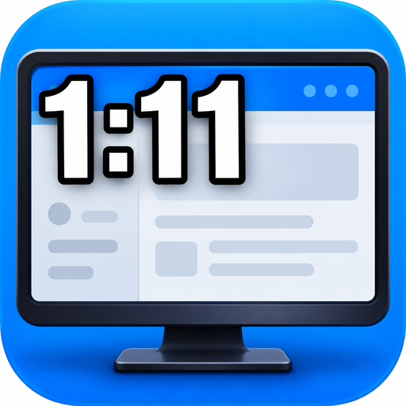
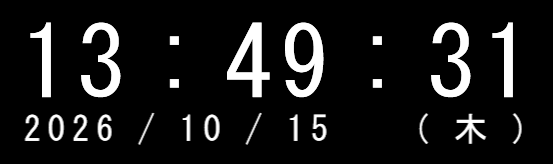
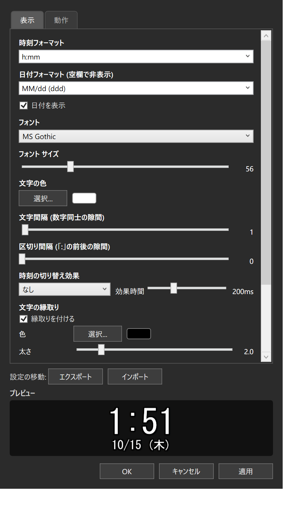
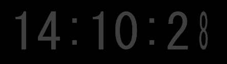
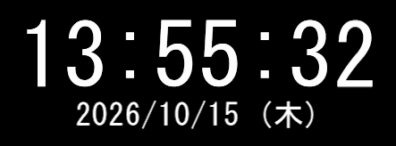
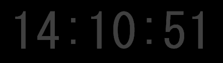

# TVClock Modern

📖 사용 설명서: [한국어](docs/USER_MANUAL.ko.md) / [日本語](docs/USER_MANUAL.md) / [English](docs/USER_MANUAL.en.md) / [简体中文](docs/USER_MANUAL.zh-Hans.md)

<p align="center">
  
</p>

> **참고: 본 프로젝트는 TVClock 및 그 저자와 어떠한 관련도 없습니다.**
> 독립적인 오픈소스 프로젝트이며, 원본 코드·리소스·상표를 일절 사용하지 않습니다.

Windows 데스크톱에 상주하는 디지털 시계입니다. **클린룸 방식으로 처음부터 새로 구현**한 범용 데스크톱 시계입니다.
.NET 8 / WPF 기반. 단일 exe·상주·저부하·크래시에 강한 설계.

 

## 특징

- **가젯 같은 상주 기능**: 항상 맨 앞 / 테두리 없음 / 배경 투명 / Alt-Tab 미표시 / 단일 exe
- **멀티 모니터 지원**: 모든 모니터 동시 표시, 모니터 지정, 모니터 구성 변경 자동 추적, Per-Monitor V2 DPI
- **풍부한 표시**: 글꼴 / 크기 / 색상 / 테두리 / 그림자 / 불투명도 / 시간·날짜 포맷 자유 설정
- **문자 단위 렌더링**: 문자 간격·구분자 간격 조절
- **굵게**: 시간과 날짜를 굵게 표시 가능(문자 탭)
- **전환 효과**: 가로 회전 / 세로 회전 / 위로 슬라이드 / 아래로 슬라이드 / 페이드 인·아웃 / 크로스페이드
- **마우스 근접 페이드**: 마우스가 가까워지면 투명해집니다. 투명 해제 키(Ctrl 등)로 일시적으로 조작 가능
- **클릭 스루**: 시계 아래를 조작 가능(트레이에서 항상 접근할 수 있으므로 갇히지 않습니다)
- **업데이트 알림**: 24시간에 한 번 시작 시 GitHub Releases를 자동 확인. 풍선 알림＋정보 탭에서 확인, 릴리스 페이지로 이동
- **다국어 UI**: 日本語 / English / 简体中文 / 한국어(동작 탭에서 전환, 즉시 적용)
- **위치 프리셋**: 좌상단 / 우상단 / 좌하단 / 우하단 / 가운데. 자릿수 변화 시 자동 재정렬
- **설정 가져오기 / 내보내기**: JSON으로 휴대 가능

## 스크린샷

**데스크톱 상주**(테두리·문자 간격·구분자 간격을 조정한 예)



**설정 화면**(변경 사항은 "적용"으로 반영)



**시간 전환 효과** — 초가 바뀔 때마다 숫자가 애니메이션으로 교체됩니다(효과 시간 50~500ms):

| 효과 | 애니메이션 |
|---|---|
| 가로 회전 |  |
| 세로 회전 |  |
| 위로 슬라이드 |  |
| 아래로 슬라이드 |  |
| 페이드 인·아웃 |  |
| 크로스페이드 |  |

## 크래시에 강한 설계

- 3중 예외 핸들러(`Dispatcher` / `AppDomain` / `TaskScheduler`) — UI 예외는 기록 후 계속 실행되고, 치명적 종료 시 **자동으로 자기 재시작**
- 설정 파일은 **원자적 쓰기 + 3단계 폴백**(본체 → 백업 → 기본값), 손상된 파일은 격리
- **초 동기 타이머**(매초 1회 기상), 페이드는 GPU 컴포지션, 근접 감시는 60Hz 폴링만 사용
- 로그: `%LOCALAPPDATA%\TVClockModern\logs\` (7일분 자동 로테이션)

## 실행 환경

- Windows 10 / 11 (x64)
- [.NET 8 Desktop Runtime](https://dotnet.microsoft.com/download/dotnet/8.0) (자체 포함 빌드에는 불필요)

## 빌드

```powershell
# 프레임워크 의존(약 150KB)
dotnet publish -c Release -o publish

# 자체 포함 단일 exe(런타임 불필요)
dotnet publish -c Release -o publish-sc -p:SelfContained=true
```

## 사용 방법

| 조작 | 동작 |
|---|---|
| 실행 | `publish\TVClockModern.exe` |
| 드래그 | 이동(위치는 자동 저장) |
| 더블클릭 | 설정 화면 |
| 우클릭 | 메뉴 |
| 작업 표시줄 트레이 | 전체 기능(클릭 스루 해제도 여기서 가능) |
| `--settings` 인수 | 설정 화면과 함께 실행(자동화용) |

설정은 `%APPDATA%\TVClockModern\settings.json`에 저장됩니다.

**자세한 사용 방법은 [사용자 매뉴얼](docs/USER_MANUAL.md)을 참조하세요.**
(모든 설정 항목 해설, 서식 지정자 목록, 멀티 모니터 동작, 문제 해결 등)

변경 이력은 [CHANGELOG.md](CHANGELOG.md)를 참조하세요.

## 면책 조항(무보증·현 상태 그대로)

본 소프트웨어는 **현 상태 그대로(AS IS)** 제공됩니다. 상품성, 특정 목적에의 적합성, 비침해를 포함하여 명시적이든 묵시적이든 어떠한 보증도 이루어지지 않습니다.

- 본 소프트웨어의 사용 또는 사용 불능으로 인해 발생한 어떠한 손해(데이터 소실, 장애, 금전적 손실 등)에 대해서도 저자는 일절 책임을 지지 않습니다
- 상주 소프트웨어의 특성상 사용 환경에 따라 예상치 못한 동작이 발생할 수 있습니다. 중요한 작업 환경에 도입하기 전에 반드시 동작을 확인하세요
- 설정 파일·로그는 사용자 본인의 책임 하에 관리해 주세요

## 라이선스

[MIT](LICENSE)

## 이름에 대하여

"TVClock Modern"이라는 이름은 기존 데스크톱 시계 앱에서 영감을 얻은 **독립 프로젝트**임을 나타내기 위한 것입니다. 다음에 해당하지 않습니다:

- 기존 TVClock(또는 기타 시계 소프트웨어)의 포크·수정·역어셈블
- 기존 소프트웨어의 저자·권리자와의 제휴·승인·후원
- 기존 소프트웨어의 리소스(이미지·아이콘·코드)의 사용
